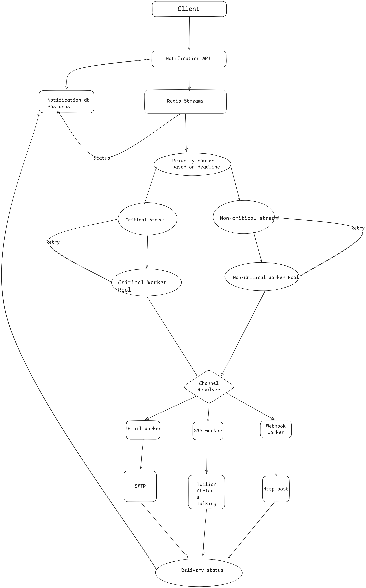

# ARCHITECTURAL DESIGN DOCUMENTATION

## OVERVIEW
This system sends notifications to users across three channels: SMS (via Twilio or Africa's Talking), email, and webhooks (HTTP POST to a target URL). Different message types carry different urgency requirements. An OTP or a 2FA code is useless if it arrives late, while a newsletter can be delayed by hours with no real consequence. The system is designed around that distinction, treating delivery speed as a first-class architectural concern rather than an afterthought.

## SYSTEM ARCHITECTURE

**Design:** [View Architecture Design](https://excalidraw.com/#room=9cdd6d7ef4618b79cd24,cNnRmLdaNxl3ej-4xWGAOg)
### Walkthrough
1. The client sends a notification request to the Notification API.
2. The Notification API validates the request, writes an intent record to the Notification DB (Postgres), and publishes the job onto Redis Streams.
3. A priority router inspects each message's deadline and routes it into one of two streams: the Critical stream or the Non-Critical stream.
4. Each stream has its own dedicated worker pool (Critical worker pool and Non-Critical worker pool), so a backlog on one side can never delay the other.
5. Failed sends are retried: each worker pool loops failed jobs back to its own stream after a backoff delay.
6. Once a worker has a job, a channel resolver decides which channel it needs (email, SMS, or webhook) and hands it to the matching channel worker.
7. Channel workers call the relevant provider (SMTP for email, Twilio or Africa's Talking for SMS, and a plain HTTP POST for webhooks).
8. Delivery outcomes are written back to the Notification DB, alongside the earlier "queued" status written when the message first entered the pipeline.

## SLA DEFINITIONS

| Message type | Target Deadline | If Missed |
|---|---|---|
| OTP / 2FA | 5–10 seconds | Message is effectively useless |
| Password reset / security alert | Under 1 minute | User experience degrades |
| Receipts / order updates | A few minutes | Minor inconvenience |
| Newsletters / bulk marketing | Hours | No real consequence |

## MESSAGE QUEUE: REDIS STREAMS
> **Decision:** Use Redis Streams, combined with a Redis sorted set for delayed retry scheduling, as the message queue instead of RabbitMQ. This decision can be revisited at scale or when a need for isolation arises.

> **Context:** The notification system needs a broker between the API and the worker pools to handle queue mechanics, delayed retries, and priority isolation between critical and non-critical traffic.

> The decision came down to one question: does this event-processing path need to be isolated from other Redis workloads, or can it safely share memory and infrastructure with them? At the system's current expected scale, there is no other Redis workload competing for the same memory, so shared infrastructure carries no meaningful contention risk.

> Given that, Redis Streams already provides what the system actually needs: consumer groups for safe multi-worker consumption, acknowledgement (XACK) so a crashed worker doesn't silently lose a message it was holding, replay of unacknowledged entries, and durable storage of stream data. Delayed retries are handled adequately by a sorted set scored by due timestamp, polled periodically, a well-understood pattern despite Redis having no native delay-queue primitive.

> If the system starts sharing a Redis cluster with other services carrying large or unpredictable memory footprints, or notification volume grows to a scale where queue and retry-set memory usage becomes a meaningful fraction of the shared instance's capacity, we'd likely move to RabbitMQ or a dedicated message broker. At that point, the isolation argument outweighs the simplicity Redis offers today.

## PRIORITY ISOLATION: TWO STREAMS AND TWO WORKER POOLS
> We split messages into two independent streams based on priority level, each with its own dedicated worker pool. This is because we prioritise speed for highly critical notifications such as OTPs, so a backlog of non-critical traffic can never delay them.

## RELIABILITY: INTENT LOGGING AND RETRIES
> Before attempting to send a message, we log the intent to the Postgres DB (status: enqueued). This is a durable write that happens before any provider is contacted, so if a worker crashes mid-send, there is always a recoverable trace of the attempt, and we don't lose anything silently.

> **Retry Policy:** we adopt exponential backoff starting at 30 seconds, doubling on each attempt, capped at 15 minutes, with maximum retry attempts set to 5. Retries are scheduled via a Redis sorted set (score = due timestamp) and re-injected into the originating stream once due.

## FAILURE HANDLING: LOGICAL DEAD LETTER QUEUE
> Once retries are exhausted, the notification record is marked status = FAILED, in_dlq = true directly on the existing row in Postgres, rather than moving the message to a separate physical dead letter queue.

## DELIVERY STATUS TRACKING
> There are two points at which we write status back to the Notification DB: an early write to register that the message has been accepted into the queue, and a final write once a channel worker has attempted delivery, recording whether it succeeded or failed.

## CONCURRENCY: CONSUMER GROUPS
> The plan is to adopt Redis consumer groups (XGROUP, XREADGROUP, XACK) for each worker pool. Without this, multiple worker instances reading the same stream independently track their own read position, which risks a message being picked up and processed more than once. Consumer groups let multiple workers within a pool safely share the load without duplication.